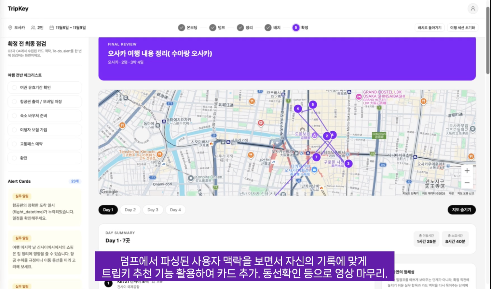
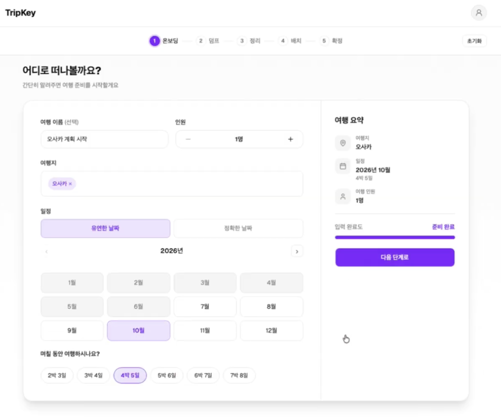
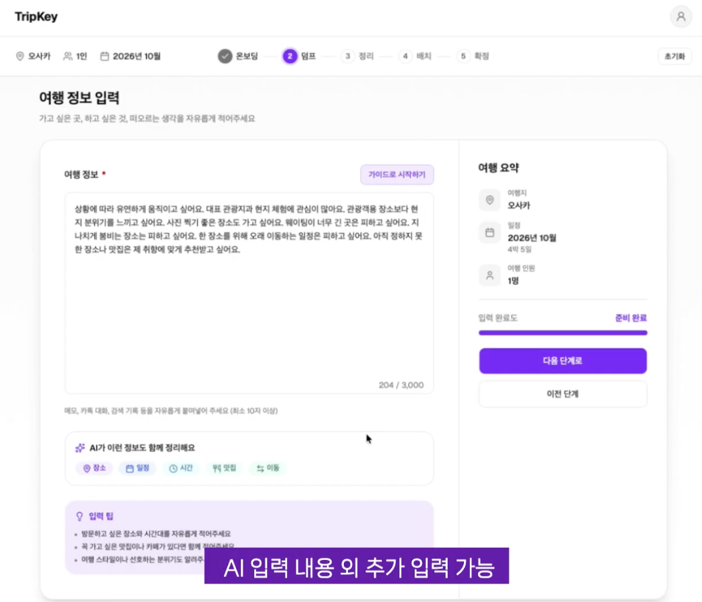
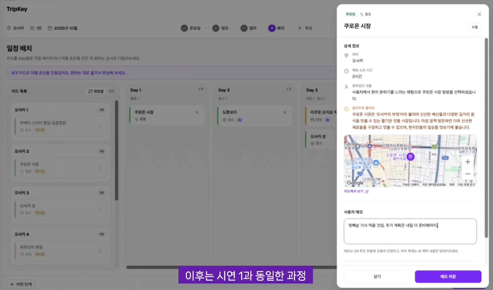

# TripKey Frontend

흩어진 여행 메모를 장소 카드로 정리하고, 날짜별 일정으로 편집·확정하는 여행 플래너입니다.

**[데모 체험하기 ↗](https://tripkey-frontend.vercel.app)** · **[원본 팀 저장소 ↗](https://github.com/TripKey/tripkey-main)**

이 저장소는 팀 프로젝트의 프론트엔드를 분리해 개인 기여와 후속 개선을 정리한 포트폴리오입니다. 데모는 로그인 없이 체험할 수 있으며, 일정 정리·배치는 PC 환경을 권장합니다.

| 항목 | 내용 |
| --- | --- |
| 팀 프로젝트 작업 기간 | 2026.04 ~ 2026.07 |
| 담당 | 온보딩·메모 입력·확정 화면, 지도·공유 기능, 기존 화면 개선 |
| 프론트엔드 기술 | React 19, TypeScript, Vite, Zustand, TanStack Query, Tailwind CSS |

원본 팀 저장소는 React 프론트엔드, Spring Boot 백엔드, FastAPI AI 엔진을 함께 관리합니다. 이 저장소에는 프론트엔드만 포함하며, AI 처리·추천과 백엔드는 팀 작업입니다. [원본 프로젝트 소개](https://github.com/TripKey/tripkey-main#프로젝트-소개)

[담당 작업](#담당한-작업) · [주요 화면](#주요-화면) · [수정 사례](#수정-사례) · [분리 후 개선](#분리-후-개선) · [데모 범위](#예제-여행-데모) · [실행 방법](#로컬-실행)

## 담당한 작업

**minsoo · 프론트엔드 개발**

- **온보딩·메모 입력** — 여행 정보와 예약 정보 입력 화면, API 연동
- **확정 화면·지도** — 날짜별 일정, 장소 마커와 호버 정보, 순서 연결선
- **공유** — 공유 링크 생성, 네이티브 공유와 클립보드 복사, 공유 링크 진입 시 편집 UI 숨김
- **기존 화면 개선** — 공통 헤더, 정리·배치 UI, 미완료 카드의 진행 제한

<details>
<summary>작업별 커밋 보기</summary>

| 영역 | 작업 내용 | 대표 커밋 |
| --- | --- | --- |
| 온보딩 | 여행지·인원·날짜 입력 UI와 여행 생성 API 연동 | [UI](https://github.com/minsoo4/tripkey-frontend/commit/ca81235), [API](https://github.com/minsoo4/tripkey-frontend/commit/f190463) |
| 메모 입력 | 입력 화면, Dump API·DTO, 항공·숙박 정보 입력 및 연동 | [화면](https://github.com/minsoo4/tripkey-frontend/commit/fab01ae), [API](https://github.com/minsoo4/tripkey-frontend/commit/a88a018), [예약 정보](https://github.com/minsoo4/tripkey-frontend/commit/c701d17) |
| 확정 화면·지도 | 확정 화면 UI, 날짜별 장소 마커, 호버 정보와 순서 연결선 | [화면](https://github.com/minsoo4/tripkey-frontend/commit/c5e2223), [지도](https://github.com/minsoo4/tripkey-frontend/commit/9de25f2) |
| 공유 | 공유 링크 생성, 네이티브 공유·클립보드 복사, 공유 화면의 편집 관련 액션 숨김 | [공유](https://github.com/minsoo4/tripkey-frontend/commit/310e6ad) |
| 기존 화면 개선 | 공통 헤더, 정리·배치 화면 UI 수정, 미완료 카드가 있을 때 다음 단계 진행 제한 | [헤더](https://github.com/minsoo4/tripkey-frontend/commit/f09a6bd), [정리](https://github.com/minsoo4/tripkey-frontend/commit/4655bdd), [배치](https://github.com/minsoo4/tripkey-frontend/commit/f8b5a9f), [진행 제한](https://github.com/minsoo4/tripkey-frontend/commit/04196c5) |
| 이벤트 분석 연동 | 제출·확정·조회·공유 시점에 PostHog 이벤트 호출 코드 추가. 실제 수집 여부는 미검증 | [이벤트 호출 추가](https://github.com/minsoo4/tripkey-frontend/commit/368ed71) |

</details>

## 주요 화면

**여행 정보 입력 → 메모의 장소 카드 변환 → 카드 검토·날짜별 배치 → 확정 및 공유**

팀 프로젝트 시연 화면입니다. 현재 공개 데모와 일부 차이가 있습니다.

### 확정 일정

날짜별 장소와 방문 순서를 지도에서 확인합니다. 연결선은 도로 기반 길찾기가 아닌 방문 순서 표시입니다.



<details>
<summary>온보딩 · 여행 정보 입력 · 일정 배치 화면 보기</summary>

**온보딩** — 여행지·인원·기간을 입력하고 요약을 확인합니다.



**여행 정보 입력** — 가고 싶은 곳과 여행 취향을 자유롭게 입력합니다. 공개 데모에서는 이 단계를 생략합니다.



**일정 배치** — 카드를 날짜별로 배치합니다. 아래는 장소 상세 정보·위치·메모 패널을 연 상태입니다.



</details>

## 수정 사례

### 01. 새로고침 후 여행 정보 유지

**문제** — 새로고침하면 여행 식별자와 입력 정보가 사라졌습니다.

**수정** — Zustand `persist`로 값을 저장하고, 캘린더 초기값과 `Date` 객체를 복원했습니다.

현재는 `sessionStorage`를 사용해 **같은 탭의 새로고침**에 대응합니다. 새 탭·다른 기기에서 식별자 없이 데이터를 복원하는 기능은 아닙니다.

[커밋 확인 ↗](https://github.com/minsoo4/tripkey-frontend/commit/4ffe19f) · [코드 보기](src/utils/calendar-store.ts)

### 02. 날짜 전환 시 기간 표시 수정

**문제** — 정확한 날짜와 유연한 날짜를 전환하면 이전 값이 남아 박·일이 잘못 표시되었습니다.

**수정** — 한 유형을 선택할 때 다른 유형의 날짜 값을 함께 초기화했습니다.

[커밋 확인 ↗](https://github.com/minsoo4/tripkey-frontend/commit/1bebf73) · [코드 보기](src/utils/calendar-store.ts)

### 03. 늦게 도착하는 지도 좌표 반영

**문제** — 장소 처리 완료 전에 진입하면 지도에 좌표가 표시되지 않았습니다.

**수정** — 처리 중인 카드가 있으면 2초 간격으로 다시 조회하고, 완료되거나 갱신 횟수 상한을 넘으면 중단하도록 했습니다.

[커밋 확인 ↗](https://github.com/minsoo4/tripkey-frontend/commit/1d94b40) · [코드 보기](src/hooks/useArrange.ts)

## 분리 후 개선

팀 프로젝트 종료 후, 백엔드 없이도 주요 화면을 체험할 수 있도록 보완한 작업입니다.

| 문제 | 변경 내용 | 확인 범위 |
| --- | --- | --- |
| 서버가 닫혀 주요 화면을 체험할 수 없음 | 기존 API 요청에 MSW가 응답하도록 구성하고 온보딩·배치·확정 상태를 메모리에 저장 | 여행 생성·조회·확정, 잘못된 요청 시 상태 보존을 API 테스트로 확인 |
| 메인 하단에서 큰 원본 이미지를 요청 | 카드 크기에 맞는 `srcSet`·`sizes`, 지연 로딩·비동기 디코딩 적용. 여행 팁 등장 효과 제거 | 초기 축소 설정에서 오사카 이미지 한 장의 응답 크기 비교 |
| 데모 사용성 보완: 하단 버튼 밀림·조회 실패 후 복구 동선 | 안내 높이를 고려한 배치 레이아웃 조정, 정리 화면 초기 조회 오류에 다시 시작 버튼 추가 | 하단 버튼·스크롤, 잘못된 tripId에서 온보딩 복귀를 수동 확인 |

초기 가로폭 축소 설정에서 오사카 이미지 한 장의 응답 크기는 원본 **약 1.70MB → 640px 축소본 약 124KB**로 줄었습니다. 이미지 응답 크기를 비교한 값이며, 페이지 로딩 시간은 별도로 측정하지 않았습니다.

<details>
<summary>이미지 비교 조건</summary>

2026.11.04, 같은 오사카 사진 URL의 HTTP `Content-Length`를 비교했습니다.

| 요청 | 응답 크기 |
| --- | --- |
| 원본 | 1,699,014바이트 |
| `auto=compress&cs=tinysrgb&w=640` 적용 | 123,763바이트 |

위 수치는 초기 설정의 단일 이미지 비교 결과입니다. 이후 선명도 보완을 위해 카드 비율(5:6)로 크롭한 WebP 이미지와 품질 85 설정으로 변경했습니다. 현재는 기기 해상도에 따라 640·960·1280px 이미지를 선택하며, 변경 후 용량과 화면 선명도는 별도 확인이 필요합니다.

</details>

[데모 구현](https://github.com/minsoo4/tripkey-frontend/commit/6cdcbdd) · [이미지 개선](https://github.com/minsoo4/tripkey-frontend/commit/ae228ff) · [오류 복구·높이 수정](https://github.com/minsoo4/tripkey-frontend/commit/94a971c)

## 예제 여행 데모

MSW가 브라우저에서 기존 API 요청에 예제 응답을 제공합니다. 별도 백엔드를 실행할 필요가 없습니다.

| 체험 항목 | 지원 범위 |
| --- | --- |
| 온보딩 | 오사카 고정, 기간(1~30일)·인원 선택 및 반영 |
| 카드 정리 | 준비된 장소 카드 4개 조회 |
| 일정 배치·확정 | 날짜·순서 변경 및 확정 결과 조회 |

- **저장:** 메모리 상태이므로 새로고침하면 초기 오사카 2일 예제로 돌아갑니다. 온보딩 입력값은 `sessionStorage`에 남을 수 있으며, 전체 초기화는 상단 로고를 사용합니다.
- **미지원:** 카드 추가·내용 수정, AI·채팅, 실제 이동 시간 계산, 수정 일정의 다른 방문자 공유·복원.
- **지도:** Google Maps API 키가 필요합니다. 키 없이도 목록·카드 이동·확정을 체험할 수 있습니다.

<details>
<summary>테스트와 확인 방법</summary>

`npm run test:demo`는 실제 MSW 핸들러로 여행 생성·조회·배치 저장·확정, 잘못된 요청의 상태 보존, 새 여행 초기화를 검사합니다. 브라우저 UI 자동화 테스트는 아닙니다.

- **기본 흐름:** 3일·3명 여행 생성 → 카드 4개 확인 → Day 3으로 카드 이동·순서 변경 → 확정 결과 확인.
- **초기화:** 온보딩에서 1일 여행을 다시 만들면 Day 1에 카드 4개가 배치됩니다. 새로고침하면 초기 예제로 돌아갑니다.
- **오류 복구:** `/grouping?tripId=wrong-id`에서 오류 안내와 다시 시작 버튼을 확인합니다.

</details>

모바일 배치 편집, 다른 화면의 오류 복구, 미배치 예제 카드·확정 전 안내는 추후 개선 대상으로 남겨두었습니다.

## 로컬 실행

Node.js 22와 npm을 기준으로 합니다.

```bash
git clone https://github.com/minsoo4/tripkey-frontend.git
cd tripkey-frontend
npm ci
npm run dev:demo
```

개발 서버: <http://localhost:3000>. 메인의 **예제 여행 체험하기**로 시작합니다. 데모는 백엔드나 환경변수 설정 없이 실행할 수 있습니다.

미리보기 주소는 기본 <http://localhost:4173>이며, 실제 주소는 터미널 출력을 확인합니다. 코드를 수정했다면 다시 빌드해야 미리보기에 반영됩니다.

Vercel의 데모 빌드 설정은 **Build Command: `npm run build:demo`**, **Output Directory: `dist`**입니다. 하위 경로 직접 접속·새로고침을 위한 SPA 라우팅 설정도 필요합니다. 일반 `npm run build`는 MSW를 활성화하지 않습니다.

<details>
<summary>환경변수와 서버 연결 설정</summary>

실제 백엔드에 연결하려면 `cp .env.example .env.local`로 설정 파일을 만들고 `npm run dev`로 실행합니다. `.env.local`에서 연결할 서버와 외부 서비스 설정을 입력합니다. 지도 키를 설정할 때도 이 파일을 사용합니다.

| 변수 | 예시 / 기본값 | 용도 |
| --- | --- | --- |
| `VITE_API_BASE_URL` | `/api` | 프론트엔드 API 요청 경로 |
| `VITE_DEV_PROXY_TARGET` | `http://localhost:8080` | 개발 서버가 요청을 전달할 백엔드 주소 |
| `VITE_GOOGLE_MAPS_API_KEY` | 직접 입력 | 지도 표시용 키 |
| `VITE_PUBLIC_POSTHOG_KEY` | 직접 입력 | PostHog 프로젝트 키 |
| `VITE_PUBLIC_POSTHOG_HOST` | `https://us.i.posthog.com` | PostHog 수집 서버 |
| `VITE_APP_ENV` | 미설정 시 `development` | 분석 이벤트의 환경 구분. 필요 시 직접 추가 |

일반 개발 모드의 서버는 `/api` 요청을 백엔드의 `/v1` 경로로 바꿔 전달합니다. 예를 들어 `/api/trips`는 기본 설정에서 `http://localhost:8080/v1/trips`로 전달됩니다. 데모 모드에서는 MSW가 해당 API 요청에 응답합니다.

지도 표시에는 Google Maps API 키가 필요합니다. 개발 모드에서는 PostHog 수집을 비활성화합니다.

Docker/Nginx 설정은 `backend:8080`에 접근할 수 있는 환경을 전제로 합니다. 이 저장소에는 백엔드와 Docker Compose 구성이 없으며, 실제 배포 시 API 프록시 주소를 환경에 맞게 설정해야 합니다.

</details>

<details>
<summary>개발 명령어</summary>

| 명령어 | 용도 |
| --- | --- |
| `npm run dev` | 개발 서버 실행 |
| `npm run dev:demo` | 백엔드 없이 MSW 데모 실행 |
| `npm run test:demo` | 데모 API 흐름 검사 |
| `npm run build` | TypeScript 빌드 검사 후 프로덕션 파일 생성 |
| `npm run build:demo` | TypeScript 빌드 검사 후 MSW를 포함한 데모 파일 생성 |
| `npm run preview` | 빌드 결과 미리보기. 개발 서버의 API 프록시 설정은 적용되지 않음 |
| `npm run lint` | ESLint 검사 |
| `npm run lint:fix` | 자동 수정 가능한 규칙 적용 |

</details>

## 라이선스

[원본 팀 저장소의 MIT License](https://github.com/TripKey/tripkey-main/blob/develop/LICENSE)
